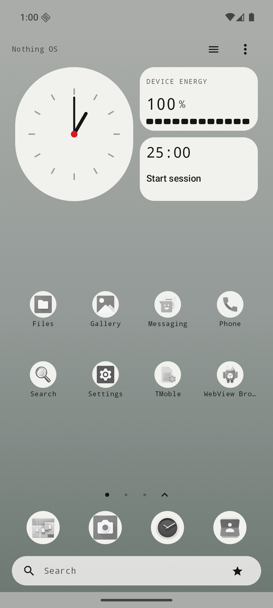
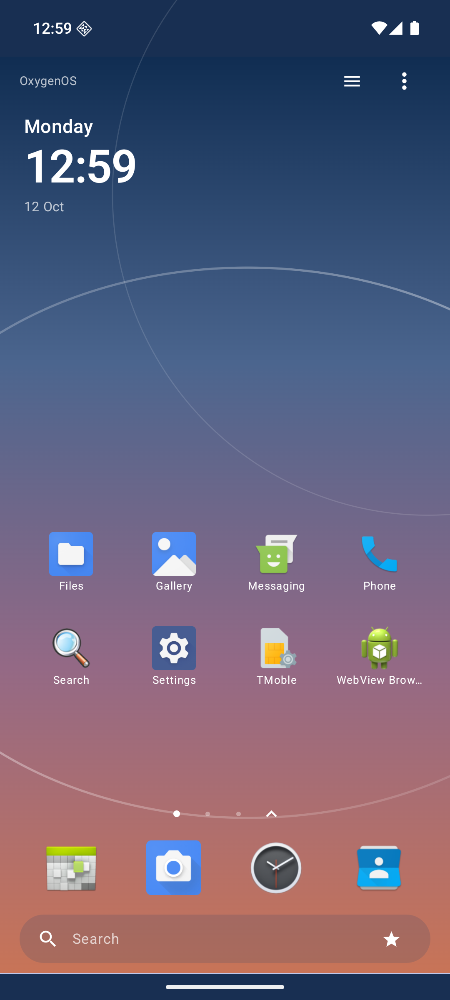
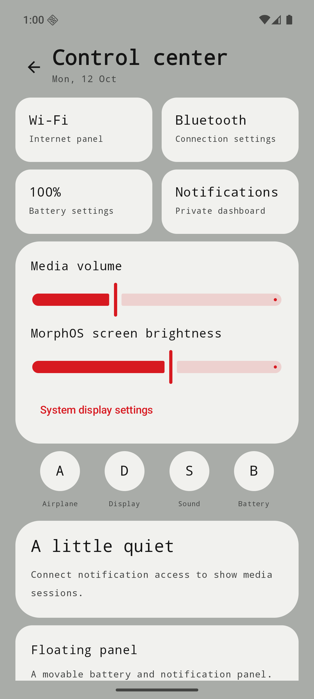
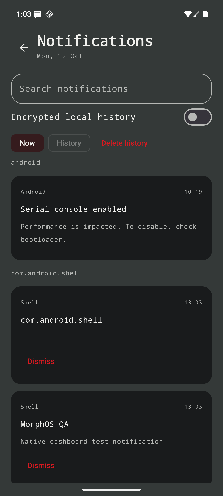
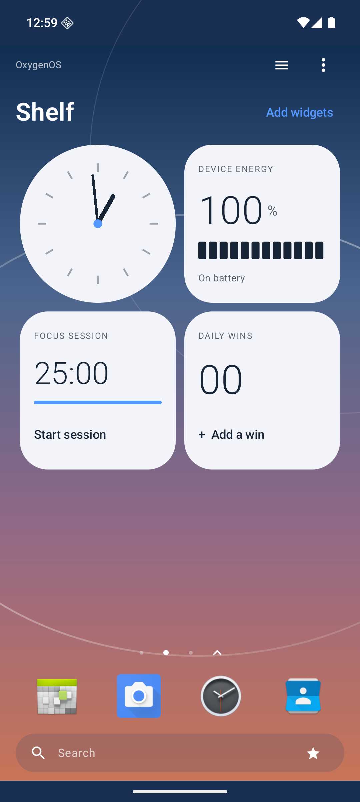
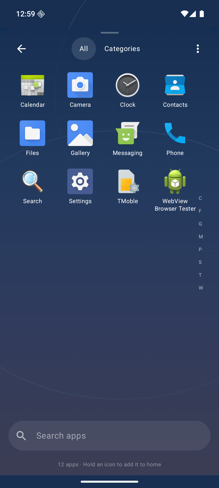
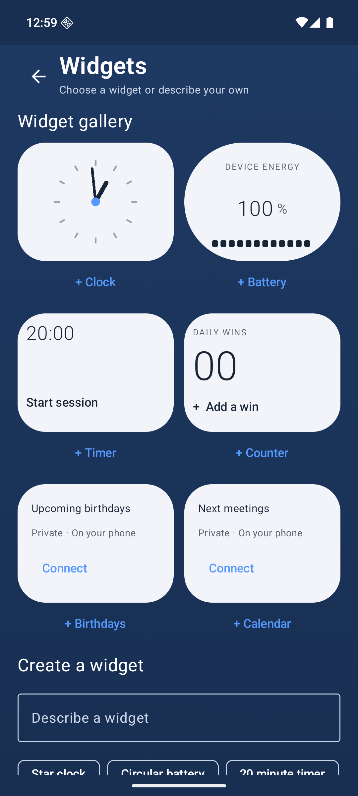
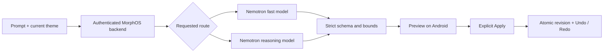
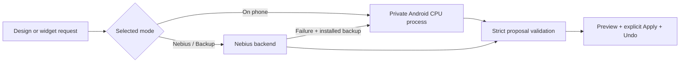

<div align="center">

# MorphOS AI

**Make your home screen feel like yours.**

A native Android launcher with expressive themes, useful widgets and a preview-first design agent.

[](https://github.com/VED045/Morph-OS/actions/workflows/ci.yml)


[See the UI](#see-the-ui) · [Try it](#1--run-the-launcher) · [Connect Nemotron](#3--connect-nebius-when-ready) · [Test results](#verification) · [Roadmap](docs/ROADMAP.md)

</div>

Launch apps, focus with a timer, find a contact, and propose a new look without losing your current layout. The launcher works offline; connected design requests use a separate FastAPI backend and Nebius Token Factory.

**Status:** native Android development MVP, version **0.4.0**. Includes editable home pages, on-phone inference, coordinated icons, local image palettes, an invite-based theme community and a paired Windows clipboard companion. Public community hosting, live Nebius credentials and physical-phone vision/performance validation remain setup/acceptance work.

**Start here → [Step-by-step phone installation, local AI, Windows pairing and theme sharing](docs/PHONE_SETUP.md).**

## See the UI

These reference screenshots show **version 0.3 running on an API 36 emulator**. Version 0.4 adds coordinated icon glyphs, community sharing and the connected clipboard; the current APK is built from the source below.

<div align="center">

&nbsp;

</div>

**Nothing OS** takes inspiration from [Nothing OS](https://in.nothing.tech/nothing-os): restrained colors, geometric widgets, dot typography and a red accent. **OxygenOS** takes cues from [OxygenOS](https://www.oneplus.com/us/oxygenos16): soft backgrounds, rounded cards and a Shelf layout. The visuals are original code-rendered assets; there is no vendor affiliation.

<details>
<summary><b>Open the control center screenshot</b></summary>



MorphOS styles its own screens. Android owns the system shade, recents and secure lock screen.



The dashboard image uses a clearly labeled real emulator test notification. Grant/revoke access was checked; notification history stayed off.

</details>

## What works today

| Area | Current implementation |
|---|---|
| Home & apps | HOME role, installed apps, horizontal pages, hold/drag, accessible placement controls and an independent four-app dock |
| Visual design | 14 offline themes, light/dark palettes, dot/digital/stacked clocks and wallpaper-derived accent |
| Design Studio | Offline commands or Nebius proposals → preview → explicit apply → undo/redo |
| Widgets | Clock, battery, timer, counter, birthdays and calendar; five shapes, grid placement, resize, scale/rotation and collection reordering |
| Drawer | Grid, list, categories, alphabetical, frequent, search-first and paginated radial modes |
| On-device AI | Private LiteRT-LM process, CPU model import/check/delete, local-only or automatic fallback, validated proposals |
| Local intelligence | Unified search, contact ranking and optional app suggestions with hide/delete controls |
| Dashboard | Authorized notifications, optional encrypted history, media controls, volume and Settings links |
| Automation | User-enabled time-window, charging and low-battery rules that select offline themes |
| Image reference | Private color extraction, local text-model refinement, optional local GPU vision, or verified remote vision → preview |
| Theme community | Export/import JSON; HTTPS browse, creator keys, upload, administrator review and preview-before-apply |
| Windows companion | Paired TLS text/image/video transfers, drag/drop window, native clipboard adapter, Android Share target and foreground sync |

Image references currently propose theme tokens. Arbitrary layout reconstruction, folders, generated widget code, external connectors and third-party Android AppWidget hosting remain backlog. [See precise scope and limitations](docs/ROADMAP.md).

## 1 — Run the launcher

**Requirements:** JDK 17, Android SDK Platform 36, Build Tools 36.0.0 and an Android 10+ device/emulator. Gradle 8.13, AGP 8.12.0 and Kotlin 2.2.21 are pinned.

1. Clone and open the project in Android Studio:

   ```bash
   git clone https://github.com/VED045/Morph-OS.git
   cd Morph-OS
   ```

2. Let Android Studio configure your SDK, or set `ANDROID_HOME`. Build:

   ```powershell
   .\gradlew.bat assembleDebug
   ```

   <details>
   <summary>Linux / macOS</summary>

   ```bash
   chmod +x gradlew
   ./gradlew assembleDebug
   ```

   </details>

3. Install on your authorized device/emulator:

   ```bash
   adb install -r app/build/outputs/apk/debug/app-debug.apk
   ```

4. Open **MorphOS AI**, tap **Set as your home launcher**, and select it in Android's dialog. To switch back, use Android Settings → Apps → Default apps → Home app.

Keep your original launcher installed. This APK uses a development signature. CI uploads a debug APK under each successful [workflow run](https://github.com/VED045/Morph-OS/actions/workflows/ci.yml).

## 2 — Take the five-minute tour

Use this checklist while trying the app:

- [ ] Open **Home options → Themes & wallpaper** and choose **Nothing OS** or **OxygenOS**.
- [ ] Swipe left/right between home pages. OxygenOS puts its widget Shelf on page two.
- [ ] Open **Home options → Edit home pages**. Hold and drag an item; drop across an edge to move it to another page. Tap an item for arrow/page/resize controls. Occupied widget cells reject a drop; app cells can swap.
- [ ] Add a page with **+ Page**. Empty pages can be removed; populated pages are protected.
- [ ] Open all apps, hold an icon and choose **Add to home** or **Add to dock**. The dock accepts four independently selected apps.
- [ ] Open **Add widgets** for the live gallery. Add a clock, battery, timer, counter, birthday or calendar widget. Use Edit home to resize it to 2×1, 2×2 or 4×2 where space allows.
- [ ] In launcher settings, try **Original**, **Monochrome** or **Follow theme** icons and the reduced-motion switch.
- [ ] Open the star for Design Studio. Try **Use a list drawer → Preview design → Apply → Undo → Redo**. Labeled offline commands make no model call.
- [ ] Swipe up on home for apps; swipe down for controls. Drawer **All / Categories**, search, alphabet rail and alternate modes help find installed apps.
- [ ] Try optional notification/media access or user-enabled offline theme rules in settings.

<details>
<summary><b>How app icons work</b></summary>

**Original is the default across themes.** MorphOS loads icons from installed applications through Android; it does not ship OnePlus or Nothing proprietary icon packs. A real OnePlus phone therefore supplies its installed app icons, while the AOSP emulator supplies AOSP icons. OEM launcher-only icon-pack overrides are not automatically inherited.

**Monochrome** uses an app's native monochrome adaptive layer on Android 13+ when available, otherwise a grayscale version of its real icon. **Follow theme** uses the theme's monochrome preference. Theme changes preserve your explicit icon choice and manually edited layout. A design request explicitly changing icon treatment switches to Follow theme as part of that undoable application.

</details>

<details>
<summary><b>Open Shelf, drawer and widget gallery screenshots</b></summary>





</details>

<details>
<summary><b>Permissions and local data</b></summary>

The base launcher needs no contacts, calendar, notification, usage or overlay authorization. Contacts/calendar widgets show a connection prompt when denied. Suggestions require opt-in; Usage Access is an additional optional source. Notification history is off by default and encrypted locally when enabled.

AI requests contain your prompt and current theme; an image is uploaded only when you tap **Analyze & preview**. Contact, calendar, notification and usage records are excluded. Provider credentials stay on the backend. [Permission and deletion details](docs/PERMISSIONS.md).

</details>

## 3 — Connect Nebius when ready

MorphOS targets the **Best Apps and Agents** track. Fast edits can use an account-available Nemotron Nano or Super model; deeper requests can route to Nemotron 3 Ultra. Exact model IDs come from your account catalog, never from guesses in the APK.

### Step A: prepare the backend

From the repository root:

```powershell
cd backend
python -m venv .venv
.\.venv\Scripts\python.exe -m pip install -r requirements-lock.txt
.\.venv\Scripts\python.exe -m pip install --no-deps .
Copy-Item .env.example .env
```

<details>
<summary>Linux / macOS setup</summary>

```bash
cd backend
python3 -m venv .venv
.venv/bin/python -m pip install -r requirements-lock.txt
.venv/bin/python -m pip install --no-deps .
cp .env.example .env
```

</details>

### Step B: configure secrets locally

Edit **backend/.env**. Set `NEBIUS_API_KEY`, then list the available models:

```powershell
.\.venv\Scripts\python.exe -m morphos.nebius
```

Copy actual account IDs into `NEBIUS_FAST_MODEL` and `NEBIUS_COMPLEX_MODEL`. Generate a separate client token using at least 32 random bytes and set `MORPHOS_CLIENT_TOKEN`. Never commit `.env` or place the Nebius key in Android.

For image requests, set `NEBIUS_VISION_MODEL` and enable `NEBIUS_VISION_VERIFIED` only after independently checking that model's image-input capability. Text Nemotron availability does not establish vision support.

### Step C: start the service and expose HTTPS

```powershell
.\.venv\Scripts\python.exe -m uvicorn morphos.main:app --host 127.0.0.1 --port 8000
```

`GET /health`, `GET /capabilities` and the local `/docs` API explorer work without inference credentials. `/design`, `/widget` and `/reference` require the client bearer token. Android accepts HTTPS backend URLs; put this service behind your HTTPS host/proxy before connecting the app.

A [Dockerfile](backend/Dockerfile) is included as a deployment starting point. Container builds, Nebius Serverless Endpoints/Jobs and public production hosting have not been verified. Serverless deployment is optional for the track.

### Step D: connect the app

Open Design Studio → **Nebius connection**. Enter the HTTPS backend URL and **MorphOS client token**. Choose **Fast route** or **Reasoning route**, request a change, inspect the preview and apply it. The screen keeps the client token in memory only.



Unknown fields, stale revisions and unsupported actions are rejected. Proposals use declarative tokens and registered widget types; generated code never executes on the device.

## 4 — Run AI directly on Android

1. Open **Design Studio → On-device AI**.
2. Download a CPU `.litertlm` file compatible with the pinned **LiteRT-LM 0.13.1** runtime. Model names alone do not establish artifact compatibility; newer exports may require newer SDKs. See [model setup and tested revisions](docs/ON_DEVICE_AI.md).
3. Tap **Import model**, select the file in Android's picker, then **Check model**. Model files stay in private app storage and are excluded from backups and Git.
4. Choose **On phone** for local inference, **Backup** to try your installed model after Nebius fails, or **Nebius** for remote-only generation.
5. Make a request, review the validated proposal, then apply or add the widget. Invalid output is rejected. The six offline widget templates remain available regardless of model quality.

Models are not bundled in the APK. Gemma downloads require accepting the source license yourself. Small phone models can handle bounded edits; they do not provide Nemotron Ultra's reasoning capacity. Image colors can be extracted entirely locally. Text models can refine those colors with your prompt; an optional compatible multimodal model can receive image input through the GPU vision runtime. The latter still needs physical-phone validation. See [phone setup](docs/PHONE_SETUP.md).



## 5 — Connect and share

<details>
<summary><b>Windows clipboard: pairing and drag/drop</b></summary>

Run `companion/start.ps1` on Windows. Pair the address, certificate fingerprint and key in Android **Settings → Windows shared clipboard**. Drop text, images or videos into the companion. Enable the two sync switches for supported automatic clipboard changes. Android clipboard reading requires MorphOS to have focus; use **Share → MorphOS** from other apps. [Full setup and limits](docs/PHONE_SETUP.md#4-connect-your-windows-laptop).

</details>

<details>
<summary><b>Community: upload and discover themes</b></summary>

Open **Themes & wallpaper → Community** to export/import a theme file or connect to a hosted HTTPS community. Creator-key uploads enter a review queue before becoming public. Only theme settings are shared. [Host your community](docs/COMMUNITY.md). No public community deployment is bundled.

</details>

## Verification

Local verification on **2026-10-12**:

| Check | Result |
|---|---|
| Android unit tests | **31 passed** |
| Android 16 / API 36 instrumentation | **10 passed** |
| Backend tests with mocked provider transport | **22 backend + 3 companion passed** |
| Debug + unsigned release APKs | **Built successfully** |
| Debug + release lint | **0 errors; 53 warnings in each variant** |
| Manual emulator smoke | Home paging/editing, theme/drawer/gallery rendering and real native model loading checked |
| Live Nebius inference / vision | **Not run — credentials deferred** |
| Physical OnePlus / other OEMs | **Not tested** |

Warnings include dependency updates, KAPT guidance, native overlay accessibility and text localization. [Full evidence and remaining checks](docs/VERIFICATION.md). This is a development snapshot, with no production-readiness claim.

<details>
<summary><b>Run the same checks</b></summary>

```powershell
.\gradlew.bat testDebugUnitTest assembleDebug assembleRelease connectedDebugAndroidTest --max-workers=1
.\gradlew.bat lintDebug lintRelease --max-workers=1 --no-daemon
cd backend
.\.venv\Scripts\python.exe -m pytest tests -q
```

Instrumentation requires a running authorized emulator/device. On Linux/macOS use `./gradlew` and `.venv/bin/python`. CI is configured for API 29 and 36; configuration alone does not establish passing remote runs.

</details>

## Explore the code

| Path | Purpose |
|---|---|
| `app/src/main/java/ai/morphos/launcher/domain` | Theme/widget schemas, patch validation, ranking and rule evaluation |
| `app/src/main/java/ai/morphos/launcher/data` | Public Android APIs, DataStore, Room, encrypted history and HTTPS client |
| `app/src/main/java/ai/morphos/launcher/ui` | Compose home, drawers, studios, search and dashboards |
| `app/src/main/assets/themes` | 14 offline theme definitions |
| `backend/morphos` | FastAPI endpoints and configurable Nebius adapter |
| `docs` | Architecture, phase records, screenshots and test evidence |

[Architecture](docs/ARCHITECTURE.md) · [Compatibility](docs/COMPATIBILITY.md) · [Roadmap](docs/ROADMAP.md) · [Privacy](docs/PERMISSIONS.md)

Version 0.4 adds community themes, paired clipboard transfers and image personalization alongside launcher, widget and local-inference improvements. Remaining acceptance work is tracked explicitly in the roadmap.
