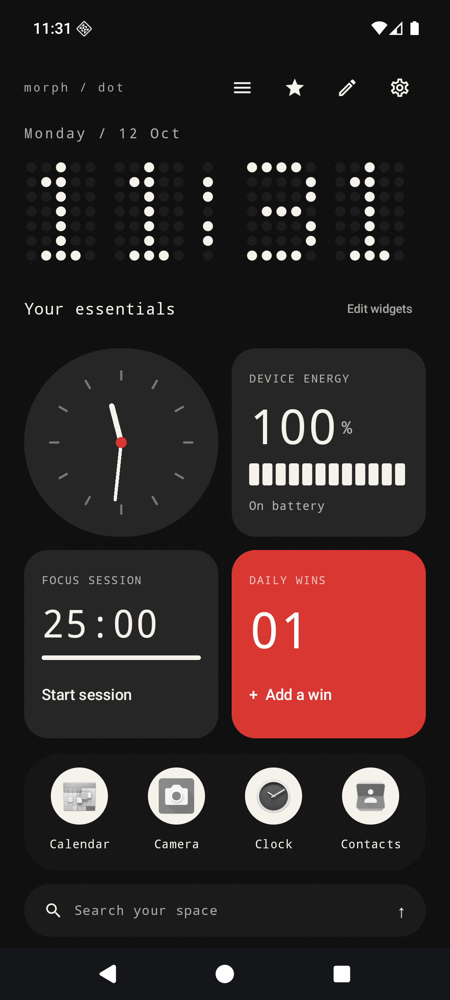
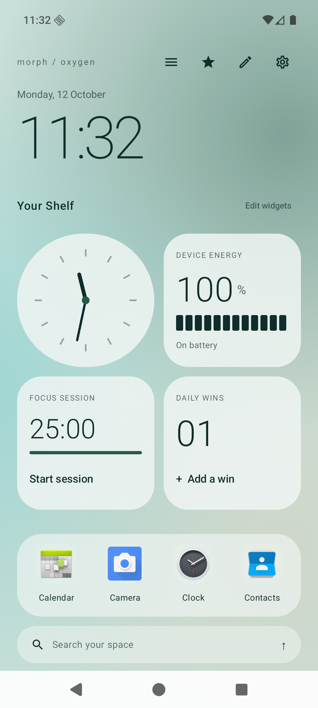
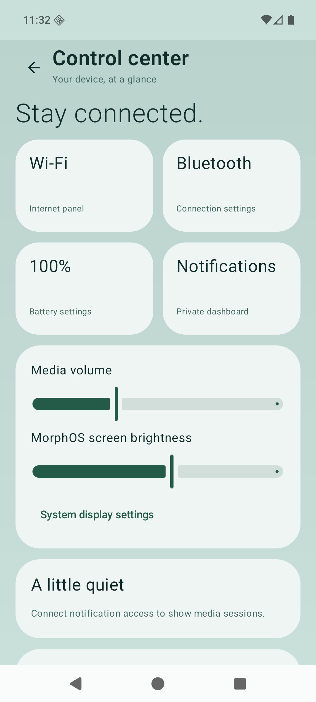
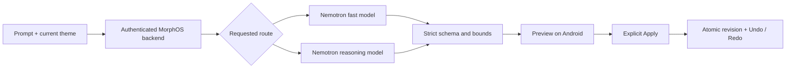

<div align="center">

# MorphOS AI

**Make your home screen feel like yours.**

A native Android launcher with expressive themes, useful widgets and a preview-first design agent.

[](https://github.com/VED045/Morph-OS/actions/workflows/ci.yml)


[See the UI](#see-the-ui) · [Try it](#1--run-the-launcher) · [Connect Nemotron](#3--connect-nebius-when-ready) · [Test results](#verification) · [Roadmap](docs/ROADMAP.md)

</div>

Launch apps, focus with a timer, find a contact, and propose a new look without losing your current layout. The launcher works offline; connected design requests use a separate FastAPI backend and Nebius Token Factory.

**Status:** a tested development MVP with features across phases 0–7. The full roadmap and production hardening are unfinished. Nebius integration is built; live inference awaits credentials and account model verification.

## See the UI

These screenshots show the **running Android app on an API 36 emulator**.

<div align="center">

&nbsp;

</div>

Dot takes inspiration from [Nothing OS](https://in.nothing.tech/nothing-os): restrained colors, geometric widgets, dot typography and a red accent. Oxygen takes cues from [OxygenOS](https://www.oneplus.com/us/oxygenos16): soft backgrounds, rounded cards and a Shelf layout. The visuals are original code-rendered assets; there is no vendor affiliation.

<details>
<summary><b>Open the control center screenshot</b></summary>



MorphOS styles its own screens. Android owns the system shade, recents and secure lock screen.

</details>

## What works today

| Area | Current implementation |
|---|---|
| Home & apps | HOME role, real installed apps, search, pins, pages and a four-app dock |
| Visual design | 14 offline themes, light/dark palettes, dot/digital/stacked clocks and wallpaper-derived accent |
| Design Studio | Offline commands or Nebius proposals → preview → explicit apply → undo/redo |
| Widgets | Clock, battery, timer, counter, birthdays and calendar; five shapes, scale/rotation and vertical reordering |
| Drawer | Grid, list, categories, alphabetical, frequent, search-first and paginated radial modes |
| Local intelligence | Unified search, contact ranking and optional app suggestions with hide/delete controls |
| Dashboard | Authorized notifications, optional encrypted history, media controls, volume and Settings links |
| Automation | User-enabled time-window, charging and low-battery rules that select offline themes |
| Image reference | Photo picker → bounded upload → separately verified vision model → theme-token proposal |

Image references currently propose theme tokens. Arbitrary layout reconstruction, generated widget code, external widget connectors and app drag/drop are backlog. [See precise scope and limitations](docs/ROADMAP.md).

## 1 — Run the launcher

**Requirements:** JDK 17, Android SDK Platform 36, Build Tools 36.0.0 and an Android 10+ device/emulator. Gradle 8.13, AGP 8.12.0 and Kotlin 2.1.20 are pinned.

1. Clone and open the project in Android Studio:

   ```bash
   git clone https://github.com/VED045/Morph-OS.git
   cd Morph-OS
   ```

2. Let Android Studio configure your SDK, or set `ANDROID_HOME`. Build:

   ```powershell
   .\gradlew.bat assembleDebug
   ```

   <details>
   <summary>Linux / macOS</summary>

   ```bash
   chmod +x gradlew
   ./gradlew assembleDebug
   ```

   </details>

3. Install on your authorized device/emulator:

   ```bash
   adb install -r app/build/outputs/apk/debug/app-debug.apk
   ```

4. Open **MorphOS AI**, tap **Set as your home launcher**, and select it in Android's dialog. To switch back, use Android Settings → Apps → Default apps → Home app.

Keep your original launcher installed. This APK uses a development signature. CI uploads a debug APK under each successful [workflow run](https://github.com/VED045/Morph-OS/actions/workflows/ci.yml).

## 2 — Take the five-minute tour

Use this checklist while trying the app:

- [ ] Tap the pencil icon, choose **Dot**, then **Dark** in settings. Try **Oxygen** with **Light** next.
- [ ] Start a focus session and add a daily win. Reopen the app to check persistence.
- [ ] Open **Edit widgets**. Try `a star clock`, preview it, then add it to home.
- [ ] Tap the star icon for Design Studio. Try **Use a dot clock** → **Preview design** → **Apply to my launcher** → **Undo** → **Redo**. The labeled offline commands make no model call.
- [ ] Search for a real app and launch it. Long press an app to pin it or open app info.
- [ ] Try a radial drawer page and its list alternative. Swipe up on the search capsule for apps; swipe down for controls.
- [ ] Open the menu icon for controls. Notification, contacts/calendar, usage and overlay access are optional.
- [ ] Open Settings → **Automation rules**. Rules start disabled. Enable one when you want it to run, then use **Check rules now**. Background checks are deferrable, with a 15-minute minimum interval.

<details>
<summary><b>Permissions and local data</b></summary>

The base launcher needs no contacts, calendar, notification, usage or overlay authorization. Contacts/calendar widgets show a connection prompt when denied. Suggestions require opt-in; Usage Access is an additional optional source. Notification history is off by default and encrypted locally when enabled.

AI requests contain your prompt and current theme; an image is uploaded only when you tap **Analyze & preview**. Contact, calendar, notification and usage records are excluded. Provider credentials stay on the backend. [Permission and deletion details](docs/PERMISSIONS.md).

</details>

## 3 — Connect Nebius when ready

MorphOS targets the **Best Apps and Agents** track. Fast edits can use an account-available Nemotron Nano or Super model; deeper requests can route to Nemotron 3 Ultra. Exact model IDs come from your account catalog, never from guesses in the APK.

### Step A: prepare the backend

From the repository root:

```powershell
cd backend
python -m venv .venv
.\.venv\Scripts\python.exe -m pip install -r requirements-lock.txt
.\.venv\Scripts\python.exe -m pip install --no-deps .
Copy-Item .env.example .env
```

<details>
<summary>Linux / macOS setup</summary>

```bash
cd backend
python3 -m venv .venv
.venv/bin/python -m pip install -r requirements-lock.txt
.venv/bin/python -m pip install --no-deps .
cp .env.example .env
```

</details>

### Step B: configure secrets locally

Edit **backend/.env**. Set `NEBIUS_API_KEY`, then list the available models:

```powershell
.\.venv\Scripts\python.exe -m morphos.nebius
```

Copy actual account IDs into `NEBIUS_FAST_MODEL` and `NEBIUS_COMPLEX_MODEL`. Generate a separate client token using at least 32 random bytes and set `MORPHOS_CLIENT_TOKEN`. Never commit `.env` or place the Nebius key in Android.

For image requests, set `NEBIUS_VISION_MODEL` and enable `NEBIUS_VISION_VERIFIED` only after independently checking that model's image-input capability. Text Nemotron availability does not establish vision support.

### Step C: start the service and expose HTTPS

```powershell
.\.venv\Scripts\python.exe -m uvicorn morphos.main:app --host 127.0.0.1 --port 8000
```

`GET /health`, `GET /capabilities` and the local `/docs` API explorer work without inference credentials. `/design`, `/widget` and `/reference` require the client bearer token. Android accepts HTTPS backend URLs; put this service behind your HTTPS host/proxy before connecting the app.

A [Dockerfile](backend/Dockerfile) is included as a deployment starting point. Container builds, Nebius Serverless Endpoints/Jobs and public production hosting have not been verified. Serverless deployment is optional for the track.

### Step D: connect the app

Open Design Studio → **Nebius connection**. Enter the HTTPS backend URL and **MorphOS client token**. Choose **Fast route** or **Reasoning route**, request a change, inspect the preview and apply it. The screen keeps the client token in memory only.



Unknown fields, stale revisions and unsupported actions are rejected. Proposals use declarative tokens and registered widget types; generated code never executes on the device.

## Verification

Local verification on **2026-10-12**:

| Check | Result |
|---|---|
| Android unit tests | **20 passed** |
| Android 16 / API 36 instrumentation | **7 passed** |
| Backend tests with mocked provider transport | **19 passed** |
| Debug + unsigned release APKs | **Built successfully** |
| Debug + release lint | **0 errors; 39 warnings in each variant** |
| Manual emulator smoke | Theme rendering, widget persistence and control center checked |
| Live Nebius inference / vision | **Not run — credentials deferred** |
| Physical OnePlus / other OEMs | **Not tested** |

Warnings include dependency updates, KAPT guidance, native overlay accessibility and text localization. [Full evidence and remaining checks](docs/VERIFICATION.md). This is a development snapshot, with no production-readiness claim.

<details>
<summary><b>Run the same checks</b></summary>

```powershell
.\gradlew.bat testDebugUnitTest assembleDebug assembleRelease connectedDebugAndroidTest --max-workers=1
.\gradlew.bat lintDebug lintRelease --max-workers=1 --no-daemon
cd backend
.\.venv\Scripts\python.exe -m pytest tests -q
```

Instrumentation requires a running authorized emulator/device. On Linux/macOS use `./gradlew` and `.venv/bin/python`. CI is configured for API 29 and 36; configuration alone does not establish passing remote runs.

</details>

## Explore the code

| Path | Purpose |
|---|---|
| `app/src/main/java/ai/morphos/launcher/domain` | Theme/widget schemas, patch validation, ranking and rule evaluation |
| `app/src/main/java/ai/morphos/launcher/data` | Public Android APIs, DataStore, Room, encrypted history and HTTPS client |
| `app/src/main/java/ai/morphos/launcher/ui` | Compose home, drawers, studios, search and dashboards |
| `app/src/main/assets/themes` | 14 offline theme definitions |
| `backend/morphos` | FastAPI endpoints and configurable Nebius adapter |
| `docs` | Architecture, phase records, screenshots and test evidence |

[Architecture](docs/ARCHITECTURE.md) · [Compatibility](docs/COMPATIBILITY.md) · [Roadmap](docs/ROADMAP.md) · [Privacy](docs/PERMISSIONS.md)

Feature development is paused at this tested snapshot. Future work should follow the documented backlog and verification gaps.
